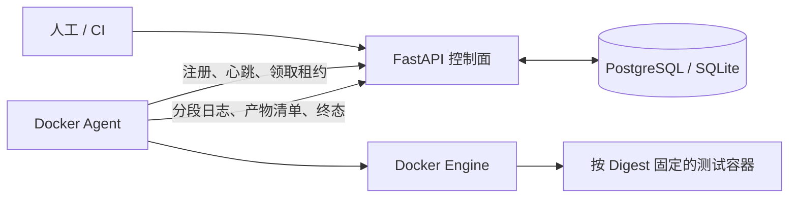

# 架构与边界

## 运行模型

TestForge 由控制面 API、关系数据库和主动拉取任务的 Agent 组成。

控制面不向 Agent 重复下发“立即执行”命令。Agent 只能使用当前执行单的租约 token 和 generation 上报，旧租约过期后无法修改新尝试。

## 数据不变性

- `Project` 保存可编辑草稿。
- `ProjectRelease` 是完整快照，带单调版本号和内容哈希，发布后无修改 API。
- `Execution` 引用确切 release，并再次固化 revision、image digest、recipe 和资源要求。
- `ArtifactManifest` 仅在 finalization 时封存，清单本身带哈希。

## 故障语义

任务失败分为 `TEST_FAILED` 和 `INFRA_FAILED`；取消为 `CANCELLED`；尚未评估为 `NOT_EVALUATED`。过期租约不会盲目重跑，执行单进入 `RECONCILING`，由运维对账容器标签后决定处置。

## 安全默认值

- 只接受包含 SHA-256 Digest 的镜像引用。
- 配方命令使用 argv 数组，不通过 shell 解析。
- 测试容器禁止提权，丢弃全部 capabilities，限制 CPU、内存和 PID。
- Agent 只挂载本次源码工作目录，不挂载 Docker Socket 到测试容器。
- 参数仅支持非敏感标量注入。生产环境的短期凭据应由后续 Secret Provider 接口注入。

## 当前实现边界

本版本是 M0/M1 基线，尚未实现设计中的 SVN、Native 高风险资源池、对象存储上传、公共服务补偿、Secret Provider、身份授权、分析平台回调和完整的自动对账决策。这些属于 M2–M4，上线前必须根据现场基础设施补齐。
