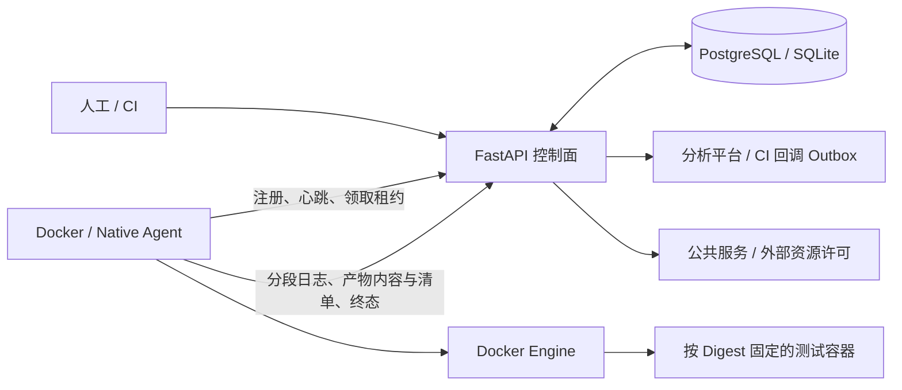

# 架构与边界

## 运行模型

TestForge 由控制面 API、关系数据库和主动拉取任务的 Agent 组成。

控制面不向 Agent 重复下发“立即执行”命令。Agent 只能使用当前执行单的租约 token 和 generation 上报，旧租约过期后无法修改新尝试。

## 数据不变性

- `Project` 保存可编辑草稿。
- `ProjectRelease` 是完整快照，带单调版本号和内容哈希，发布后无修改 API。
- `Execution` 引用确切 release，并再次固化 revision、image digest、recipe 和资源要求。
- `ArtifactManifest` 仅在 finalization 时封存，清单本身带哈希。

## 故障语义

任务失败分为 `TEST_FAILED` 和 `INFRA_FAILED`；取消为 `CANCELLED`；尚未评估为 `NOT_EVALUATED`。过期租约不会盲目重跑，执行单进入 `RECONCILING`。Agent 使用容器上的 execution/generation 标签接管存量运行；已开始任务不允许自动重跑。

## 安全默认值

- 只接受包含 SHA-256 Digest 的镜像引用。
- 配方命令使用 argv 数组，不通过 shell 解析。
- 测试容器禁止提权，丢弃全部 capabilities，限制 CPU、内存和 PID。
- Agent 只挂载本次源码工作目录，不挂载 Docker Socket 到测试容器。
- 参数按发布版 JSON Schema 校验，日志在入库前脱敏。外部服务认证仅保存环境变量引用，不持久化密文。
- Native 执行默认禁用，必须在 `executor_pool=native` 独立 Agent 上显式开启。
- 控制面和 Agent 凭据分离，所有写操作记录 actor、request id、路径和结果。

## 生产适配点

设计文档未指定的企业基础设施通过稳定边界接入：公共服务/资源许可使用幂等 HTTP 契约；分析平台和 CI 使用 Outbox 回调；Dockerfile 由隔离构建服务领取 build 记录并回填扫描后 Digest。默认产物存储是带原子替换的本地参考实现；生产部署需将该存储边界配置到现场对象存储，并将 API Key 换成现有 IdP 签发的短期凭据。
